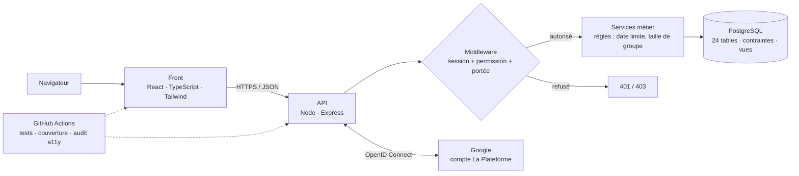

# ProjetGlobe - Refonte de l'intranet

> **Un intra pour les gouverner tous.** Dossier de cadrage et de conception de la refonte de l'intranet d'un organisme de formation : un projet sur plusieurs années, livré en plusieurs versions, conçu pour pouvoir devenir un SaaS.

Projet pédagogique — Master 1, La Plateforme. Ce dépôt ne contient **pas de code applicatif** : il contient la compréhension du besoin et la documentation qui permettra à une équipe de construire l'intranet et de le faire vivre.

---

## Sommaire

1. [Le besoin en bref](#1-le-besoin-en-bref)
2. [Livrables](#2-livrables)
3. [Organisation du dépôt](#3-organisation-du-dépôt)
4. [Architecture cible](#4-architecture-cible)
5. [Modèle de données](#5-modèle-de-données)
6. [Afficher et tester les modèles](#6-afficher-et-tester-les-modèles)
7. [Méthode et organisation](#7-méthode-et-organisation)
8. [Planning](#8-planning)
9. [Tests et recette](#9-tests-et-recette)
10. [Documentation just-in-time](#10-documentation-just-in-time)
11. [Definition of Done](#11-definition-of-done)
12. [Décisions et hypothèses](#12-décisions-et-hypothèses)

---

## 1. Le besoin en bref

| Indice du sujet | Conséquence dès la V1 |
| --- | --- |
| Projet sur plusieurs mois, voire plusieurs années | Scrum, backlog priorisé, documentation qui vit avec le code |
| Plusieurs versions | V1 assumée (MoSCoW), V2 et V3 planifiées |
| Évolution possible en SaaS | Utilisateurs, promotions et UF rattachés à une **organisation** |
| Rôles et types de promotions variés | Rôles, permissions et types de promotion **stockés en base** |

**Acteurs** : étudiant, accompagnateur, responsable pédagogique, intervenant externe, administrateur.
**Exigences** : 30 fonctionnelles (22 Must en V1, 5 Should, 3 Could) et 9 non fonctionnelles (sécurité, RGPD, accessibilité RGAA 4.1.2, performance, évolutivité, maintenabilité).

**Product Goal** : *offrir un intranet unique où chaque étudiant gère son parcours projet de l'inscription à l'évaluation, et où l'équipe pédagogique pilote ses promotions selon son rôle, sur une architecture prête à accueillir d'autres établissements.*

---

## 2. Livrables

| Fichier | Contenu | Responsable |
| --- | --- | --- |
| `organigramme.pdf` | Équipe projet, rôles, responsable de chaque document | Scrum Master |
| `cr_choix_methode.pdf` | Choix de Scrum, méthodes écartées, note de cadrage, plan de documentation just-in-time, Definition of Done | Scrum Master |
| `cahier_des_charges.pdf` | Besoin, acteurs, cas limites, exigences (EX-xx, ENF-xx), matrice des droits, RGPD, accessibilité | Product Owner |
| `database_scheme.pdf` | MCD Merise/2, règles de gestion, MLD, MPD PostgreSQL, choix de modélisation | Tech lead |
| `application_diagram.pdf` | Diagramme de classes, cohérence entités ↔ classes, diagrammes comportementaux | Tech lead |
| `planning.pdf` | Feuille de route des sprints, déroulé d'un sprint, tableau Scrum | Scrum Master |
| `plan_tests_recette.pdf` | Stratégie de tests, planification, cahier de recettes (47 scénarios) | Tech lead, Product Owner |
| `onboarding.pptx` | Présentation d'accueil du nouveau développeur (support de soutenance) | Toute l'équipe |
| `modeles/` | Scripts des modèles : MCD, MPD, UML, tests SQL | Tech lead |

---

## 3. Organisation du dépôt

```text
projet-globe/
├── README.md                     ← ce fichier
├── organigramme.pdf
├── cr_choix_methode.pdf
├── cahier_des_charges.pdf
├── database_scheme.pdf
├── application_diagram.pdf
├── planning.pdf
├── plan_tests_recette.pdf
├── onboarding.pptx
└── modeles/
    ├── README.md                       outils et commandes pour chaque script
    ├── mcd.mcd                         MCD Merise/2 (Mocodo)
    ├── mcd.png / mcd.svg               rendu du MCD
    ├── mpd_postgresql.sql              MPD : 24 tables, contraintes, déclencheur, vues
    ├── mpd_dbdiagram.dbml              MPD pour dbdiagram.io
    ├── mpd_mermaid.mmd                 MPD pour Miro / GitHub (Mermaid)
    ├── tests_regles_metier.sql         jeu de données + tests des règles
    ├── diagramme_classes.puml          diagramme de classes (PlantUML)
    ├── diagrammes_comportementaux.puml cas d'utilisation, états, séquence
    └── *.png                           rendus des diagrammes
```

Structure cible du code, créée au sprint 0 :

```text
apps/web/      front React + TypeScript + Tailwind (pages, composants Storybook)
apps/api/      API Node + Express (routes, middlewares auth/droits, services, migrations)
docs/adr/      décisions d'architecture, une par fichier
.github/       intégration continue (GitHub Actions)
docker-compose.yml
```

---

## 4. Architecture cible



| Composant | Technologie | Rôle |
| --- | --- | --- |
| Front | React, TypeScript, Tailwind | Écrans étudiant et équipe pédagogique, accessibles (RGAA 4.1.2) |
| API | Node.js, Express | Routes REST documentées en OpenAPI |
| Contrôle des droits | Middleware | Vérifie session, permission (rôle) et portée (promotion accompagnée, projet assigné) à **chaque** requête |
| Base de données | PostgreSQL | Contraintes métier en dernier recours, vues statistiques |
| Authentification | Google OpenID Connect | Jeton vérifié côté serveur (signature, audience, domaine) ; invitation pour les intervenants externes |
| Environnement | Docker | Même environnement en local et en recette |
| CI | GitHub Actions | Tests, seuil de couverture, audit d'accessibilité à chaque pull request |

Le parcours d'une requête (exemple : rendre un projet, avec les refus 401, 403 et 422) est décrit par le diagramme de séquence dans `application_diagram.pdf`.

---

## 5. Modèle de données

- **Méthode** : Merise/2 (MCD → MLD → MPD).
- **16 entités, 21 associations**, une spécialisation **XT** : un utilisateur est soit étudiant, soit membre de l'équipe, jamais les deux.
- **24 tables** PostgreSQL (16 entités + 8 tables de liaison), 2 vues statistiques.

| Besoin du sujet | Réponse dans le modèle |
| --- | --- |
| Rôles différents (responsable, accompagnateur, intervenant…) | `role`, `permission`, `accorder`, `posseder` : rôles cumulables et configurables |
| Portée des droits | `accompagner` (membre ↔ promotions), `intervenir` (membre ↔ projets) |
| Types de promotions | `type_promotion` (modalité, durée, rythme) |
| Redoublement, ancien étudiant | `inscrire` : dates d'entrée et de sortie, statut de parcours |
| Un étudiant, un seul groupe par projet | `composer` : `UNIQUE (id_etudiant, id_projet)` + clé composite vers `groupe` |
| Évaluation par compétence | `evaluation` : étudiant × compétence × rendu, niveau de 1 à 4 |
| Temps de log | `session_log` + vue `v_temps_log_etudiant` |
| Statistiques de promotion | vue `v_moyenne_competence_promotion` |
| Passage en SaaS | `organisation` liée aux utilisateurs, promotions et UF |

**Si l'intranet devenait un SaaS demain** : isolation des données par ligne (Row-Level Security PostgreSQL sur `id_organisation`), référentiels propres à chaque client, entité `abonnement`.


---

## 6. Afficher et tester les modèles

| Modèle | Fichier | Outil |
| --- | --- | --- |
| MCD (et MLD généré) | `modeles/mcd.mcd` | [mocodo.net](https://www.mocodo.net) → coller → « Générer » |
| MPD (schéma) | `modeles/mpd_dbdiagram.dbml` | [dbdiagram.io](https://dbdiagram.io/d) → remplacer le contenu de l'éditeur |
| MPD (Miro, GitHub) | `modeles/mpd_mermaid.mmd` | Miro → app Mermaid ; s'affiche aussi directement sur GitHub |
| Diagramme de classes | `modeles/diagramme_classes.puml` | [plantuml.com](https://www.plantuml.com/plantuml), Miro (app PlantUML), draw.io |
| Diagrammes comportementaux | `modeles/diagrammes_comportementaux.puml` | Idem, un bloc `@startuml … @enduml` à la fois |

### Lancer la base et voir le modèle dans DBeaver

```bash
# 1. Démarrer PostgreSQL (port 5433 pour éviter un PostgreSQL local déjà installé)
docker run -d --name globe-pg -e POSTGRES_PASSWORD=globe -p 5433:5432 postgres:16

# 2. Créer le schéma
docker cp modeles/mpd_postgresql.sql globe-pg:/tmp/
docker exec -it globe-pg psql -U postgres -f /tmp/mpd_postgresql.sql

# 3. Lancer les tests des règles métier (6 erreurs attendues, chacune annoncée)
docker cp modeles/tests_regles_metier.sql globe-pg:/tmp/
docker exec -it globe-pg psql -U postgres -f /tmp/tests_regles_metier.sql
```

Dans DBeaver : nouvelle connexion PostgreSQL → `localhost`, port `5433`, utilisateur `postgres`, mot de passe `globe`. Puis *Schémas* → `public` → clic droit → **Afficher le diagramme**.

Ce que vérifient les tests : un étudiant ne peut pas être dans deux groupes du même projet, un groupe ne peut pas être rattaché au mauvais projet, un rendu sans lien ni fichier est refusé, un niveau hors de l'échelle 1 à 4 est refusé, une double évaluation est refusée, seul un membre de l'équipe peut évaluer. Le déclencheur XT refuse aussi qu'un utilisateur soit à la fois étudiant et membre.

---

## 7. Méthode et organisation

**Scrum**, sprints de 2 semaines, Sprint Review avec le directeur.

| Méthode | Décision | Raison |
| --- | --- | --- |
| Scrum | ✅ Retenue | Besoins évolutifs, versions successives, retour régulier du directeur |
| Cycle en V | Écartée | Besoins figés au départ, rien de visible avant des mois |
| Kanban seul | Écartée (gardée pour la maintenance) | Pas de rythme de revue ni d'objectif de version |
| SAFe | Écartée | Fait pour plusieurs équipes, trop lourd pour 6 personnes |
| XP | Pratiques reprises | Intégration continue et revue de code, intégrées à la DoD |

**Équipe** (6 personnes, 5,5 ETP) : Product Owner, Scrum Master, Tech lead, 2 développeurs full-stack, 1 développeur front et accessibilité. Le directeur de l'organisme est sponsor ; le directeur technique cadre la méthode et l'architecture.

---

## 8. Planning

| Sprint | Semaines | Objectif |
| --- | --- | --- |
| Sprint 0 | 1 | Socle technique, CI, maquettes |
| Sprint 1 | 2–3 | Connexion Google et droits par rôle |
| Sprint 2 | 4–5 | Promotions, étudiants, UF, projets |
| Sprint 3 | 6–7 | Inscription, groupes, rendu |
| Sprint 4 | 8–9 | Évaluation, temps de log, statistiques |
| **V1** | **fin sem. 9** | **22 exigences Must validées en recette** |
| Sprint 5 | 10–11 | Types de promotion, archivage, feedback |
| Sprint 6 | 12–13 | Import CSV, export, notifications, RGPD outillé |
| **V2** | **fin sem. 13** | **Exigences Should et Could validées** |
| V3 | à estimer | SaaS multi-établissement |

Hypothèse : vélocité de 28 points par sprint, à recaler après les sprints 1 et 2.

---

## 9. Tests et recette

| Type | Quand | Outil |
| --- | --- | --- |
| Unitaire | À chaque commit | Vitest |
| Intégration / API (dont refus 401, 403, 422) | À chaque pull request | Supertest + PostgreSQL de test |
| Règles du schéma | À chaque migration | `tests_regles_metier.sql` |
| Bout en bout | Avant chaque Sprint Review | Playwright |
| Accessibilité | À chaque pull request + contrôle manuel par version | axe-core, NVDA |
| Performance | Avant chaque version | k6 |
| Recette | Fin de sprint + recette complète par version | `plan_tests_recette.pdf` |

**Cahier de recettes** : 47 scénarios, dont 37 pour la V1. Chaque exigence EX-xx a son scénario REC-xx. Six tests de refus d'accès (REC-31 à REC-36), par exemple un accompagnateur qui tente de supprimer une promotion.

**Traçabilité** : besoin → exigence (EX-xx) → conception (table, classe) → test (REC-xx). Exemple complet dans `plan_tests_recette.pdf`, section 5.

---

## 10. Documentation just-in-time

On **fige** ce qui exprime un besoin ou une décision (cahier des charges, Product Goal, choix de méthode, conception de référence V1). On laisse **vivre** ce qui décrit le code.

| Document | Quand | Qui | Où / outil | Garantie |
| --- | --- | --- | --- | --- |
| API | À chaque route, dans le ticket | Développeur, revu par le Tech lead | OpenAPI, `/api/docs` | DoD + CI bloquante |
| Composants | À chaque composant | Développeur front | Storybook | DoD + audit a11y |
| Schéma de BDD | À chaque migration | Développeur, validé par le Tech lead | `modeles/` | Pas de fusion sans scripts à jour |
| Décisions d'architecture | À chaque choix structurant | Tech lead | `docs/adr/` | Revue en rétrospective |
| Couverture de tests | À chaque pull request | Développeurs | Rapport CI | 60 % (V1), 70 % (V2), 80 % (V3) |
| Cahier de recettes | À chaque story livrée | PO + Tech lead | `plan_tests_recette` | Story non terminée sans REC |
| README | À chaque changement d'installation | Développeur du ticket | Ce fichier | DoD + test par chaque nouvel arrivant |
| CHANGELOG | À chaque version | Scrum Master | `CHANGELOG.md` | Critère de sortie de version |

---

## 11. Definition of Done

Une story est terminée quand :

- [ ] ses critères d'acceptation (EX-xx) sont validés par le PO ;
- [ ] le code est revu et la pull request approuvée ;
- [ ] les tests passent en CI, au-dessus du seuil de couverture de la version ;
- [ ] son scénario de recette REC-xx est rédigé et passé, refus d'accès compris ;
- [ ] l'audit d'accessibilité ne remonte aucune erreur bloquante ;
- [ ] la documentation vivante est à jour (OpenAPI, Storybook, scripts du modèle, README) ;
- [ ] elle est déployée sur l'environnement de recette.

---

## 12. Décisions et hypothèses

**Décisions de cadrage** (zones floues du sujet) :

- **Temps de log** = durée des sessions connectées à l'intranet ; une session inactive 30 min est clôturée.
- **Intervenants externes** : connexion sur invitation nominative.
- **Groupes** : formés par les étudiants, validés par un accompagnateur.
- **Évaluation** : 4 niveaux (non acquis, en cours, acquis, maîtrisé).
- **Suppression** : archivage plutôt que suppression ; anonymisation en fin de conservation.
- **Rôles** : cumulables ; l'accompagnateur voit les statistiques de ses promotions.

**Hypothèses à valider avec le directeur** : performance (95 % des pages en moins de 2 s pour 500 utilisateurs), disponibilité de 99 %, budget V1 d'environ 247 jours-homme (≈ 99 k€ à 400 €/jour), vélocité de 28 points par sprint, durées de conservation RGPD (à valider avec le référent RGPD ; la fourchette de 6 mois à 1 an pour le journal d'audit suit la recommandation de la CNIL).

---

### Références

- [RGAA 4.1.2](https://accessibilite.numerique.gouv.fr/doc/RGAA-v4.1.2.odt)
- [CNIL — recommandation sur la journalisation (2021)](https://cnil.fr/la-cnil-publie-une-recommandation-relative-aux-mesures-de-journalisation)
- [Scrum Guide 2020](https://scrumguides.org/scrum-guide.html)
